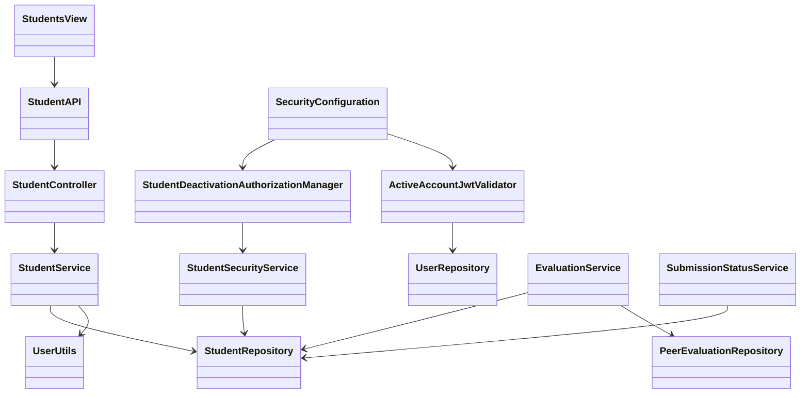

# Student Design

> Realizes: [UC-STU-deactivate-student](../requirements/use-cases.md#uc-stu-deactivate-student-the-course-admininstructor-deactivates-a-student)
> Depends on FRs: FR-SEC-active-account, FR-SEC-authorization ([SRS](../requirements/software-requirements-specification.md#non-use-case-functional-requirements))
> See: [business rules](../requirements/business-rules.md), [architecture containers](architectural-design.md#containers), [architectural conventions](architectural-design.md#architectural-conventions), [authorization](architectural-design.md#authorization)

## Overview

The student slice adds a dedicated deactivation operation using the existing Vue, Spring Security, service transaction, and Result-envelope architecture. Evaluation and notification integrations realize the policies cited by the use case. This design of record was approved in merged design PR #2; implementation began in a fresh session from that merge. Reactivation implementation is excluded.

## Components & classes



| Component | Reused / new | Responsibility / file |
|---|---|---|
| Student management | Extend | [Students.vue](../../frontend/src/pages/students/Students.vue): dedicated action after student details, warning, pending state, status refresh; action also handles a stale active row. |
| Student edit | Extend | [EditStudentForm.vue](../../frontend/src/pages/students/EditStudentForm.vue): prevent true-to-false status changes through generic editing; retain the existing false-to-true path without implementing the reactivation use case. |
| Student API | Extend | [index.ts](../../frontend/src/apis/student/index.ts), [types.ts](../../frontend/src/apis/student/types.ts): typed deactivation call through the shared request instance. |
| Controller and DTO converter | Extend / reuse | [StudentController](../../backend/src/main/java/team/projectpulse/student/StudentController.java) adds the endpoint, reusing the existing StudentDto and converter; distinguish already inactive from changed status in the service result. |
| Student service / repository | Extend | [StudentService](../../backend/src/main/java/team/projectpulse/student/StudentService.java), [StudentRepository](../../backend/src/main/java/team/projectpulse/student/StudentRepository.java): scoped transactional lookup, idempotent flag change, generic-edit bypass prevention. |
| Deactivation guard | New / extend | New `security/authorizationmanagers/StudentDeactivationAuthorizationManager.java`; extend [StudentSecurityService](../../backend/src/main/java/team/projectpulse/student/StudentSecurityService.java) with assigned-instructor OR owning-course-admin check, gated by role. Do not widen guards used by unrelated routes. |
| Active-account validation | New / extend | New `security/ActiveAccountJwtValidator.java`, wired in [SecurityConfiguration](../../backend/src/main/java/team/projectpulse/security/SecurityConfiguration.java), reading [UserRepository](../../backend/src/main/java/team/projectpulse/user/UserRepository.java). |
| Evaluations | Extend | [EvaluationService](../../backend/src/main/java/team/projectpulse/evaluation/EvaluationService.java), [PeerEvaluationRepository](../../backend/src/main/java/team/projectpulse/evaluation/PeerEvaluationRepository.java), [SubmitTeamsEvaluations.vue](../../frontend/src/pages/evaluations/SubmitTeamsEvaluations.vue): eligibility and weekly report inclusion. |
| Submission status / reminders | Reuse | [SubmissionStatusService](../../backend/src/main/java/team/projectpulse/notification/SubmissionStatusService.java): existing BR-submission-owed filtering, verified by regression tests. No new reminder policy or parallel eligibility service. |

The components above are implemented on the build branch. Execution evidence and remaining review work are recorded in [the verification notes](../guides/stu-deactivation-verification.md).

## Sequence

### Deactivate student

```mermaid
sequenceDiagram
    actor Instructor
    participant UI as Student management
    participant API as Spring Security / StudentController
    participant Guard as Deactivation authorization
    participant Service as StudentService
    participant DB as StudentRepository
    Instructor->>UI: View details and choose Deactivate (steps 1-3)
    UI-->>Instructor: Consequences, Confirm and Cancel (step 4)
    Instructor->>UI: Confirm (step 5)
    UI->>API: PUT /api/v1/students/{studentId}/deactivate
    API->>Guard: Active caller, role and target ownership
    Guard-->>API: Authorized
    API->>Service: deactivateStudent(studentId)
    Service->>DB: Lookup by target ID and caller-authorized scope
    DB-->>Service: Student
    Service->>DB: Set enabled=false if active; commit
    Service-->>API: Student and changed/already-inactive outcome
    API-->>UI: Result with StudentDto (step 6)
    UI-->>Instructor: Success and refreshed status
```

### Cancellation, refusal, and existing credentials

```mermaid
sequenceDiagram
    actor Caller
    participant UI as Student management
    participant API as Security filter chain
    participant Guard as Authorization / account validation
    participant DB as Database
    alt Cancel or dismiss warning (4a)
        Caller->>UI: Cancel, close or dismiss
        Note over UI: No deactivation request; no state change
    else Unauthorized target (3a)
        Caller->>API: Deactivate target
        API->>Guard: Check role and target scope
        Guard-->>API: Denied
        API-->>Caller: 403 Result; no mutation
    else Inactive student uses old JWT (6b)
        Caller->>API: Protected request with signed unexpired JWT
        API->>Guard: Normal JWT validation plus active-account check
        Guard->>DB: Read current account by token userId
        DB-->>Guard: Inactive
        Guard-->>API: Authentication rejected
        API-->>Caller: 401 Result
    end
```

## API contract

| Endpoint or job | Caller | Request | Success | Errors / extensions |
|---|---|---|---|---|
| **Existing** `GET /api/v1/students/{studentId}` | Existing self/assigned-instructor callers, plus the owning course admin | Target ID in path | Existing StudentDto details, so an owning admin can complete step 2 even without section assignment | Compose the existing route guard with the dedicated deactivation guard on this GET route only; shared guards and other routes retain their rules. |
| **New** `PUT /api/v1/students/{studentId}/deactivate` | Active assigned instructor or owning course admin | Target ID in path; no body | HTTP 200; `Result(flag=true, code=200, message, data=StudentDto)` with `enabled=false`; changed: "Student deactivated successfully"; 6a: "Student is already deactivated" | 401 missing/invalid credentials or inactive caller (6b); 403 role/scope refusal or guard-unresolvable ID (3a); 404 if service scoped lookup fails after guard success; 400 unbindable ID if it reaches binding. No mutations on refusal. |
| **Existing** `PUT /api/v1/students/{studentId}` | Existing authorized callers | Existing StudentDto plus required boolean query parameter `expectedEnabled`, captured when the form loads | Existing profile-update response | Reject an attempted active-to-inactive transition with 400 and an instruction to use the dedicated deactivation action; do not save profile changes on that failure (T13). 409 if stored status differs from expectedEnabled, with no profile changes and an instruction to refresh. Missing expectedEnabled is 400. Existing intentional false-to-true behavior is retained when expectedEnabled=false, not expanded. |
| **Existing** evaluation creation | Active student on a team | Existing contract | Existing Result | 400 with named inactive-evaluatee condition if target became inactive; 401 for inactive evaluator's credentials. Same-team and submission-window checks still apply. Existing evaluation edits retain their current window rules. A named inactive-target rejection leaves the evaluation screen available with a Refresh teammates action; refreshing reloads the current roster, removes inactive targets from new evaluation entry, and allows continuation without silently submitting any draft. |
| **Existing** weekly course section evaluation report | Existing scoped instructor/admin access | Existing course section ID / week | Existing report shape; row inclusion follows BR-evaluation-active-participants | Existing error contract; no new endpoint or persistence format. |

A malformed target denied by the route guard is 403, following the architecture's fail-closed guard convention; it must not become 500. Request bodies are absent on the new operation, so no request DTO or @Valid body is needed there. Existing body-based endpoints retain validation. Both generic profile callers, EditStudentForm.vue and currentUser/UserInfo.vue, pass their originally loaded status as expectedEnabled; neither replaces it with the edited desired status. A 409 keeps the form open and asks for refresh without automatic retry.

## Key decisions

- **Dedicated idempotent PUT:** a state-setting operation supports retries and stale screens without conflict errors. Rejected generic profile editing as the deactivation operation because it bypasses the required warning; rejected a toggle endpoint because retrying could reactivate an account. The service returns a changed/already-inactive outcome for the controller's accurate message.
- **Two authorization enforcement points:** the new manager checks instructor/admin role and target course section/course ownership, with no self-access alternative. The service repeats that scope in a repository query using caller ID/roles from UserUtils: target ID AND (assigned instructor OR owning course admin). The student-details GET composes its existing guard with this dedicated guard so an owning course admin can complete step 2 without section assignment; the shared guard and unrelated routes are unchanged. This scoped route addition was approved during implementation after the existing details guard was found to exclude that actor. Do not use the caller's selected default course section as the authorization boundary; an instructor may teach multiple course sections. Rejected reusing UserOwnershipAuthorizationManager, which permits student self-access, and rejected unscoped loading followed only by an ownership comparison.
- **Current account status on JWT authentication:** compose ActiveAccountJwtValidator with the decoder's existing/default issuer-independent signature/time validation, including expiry and not-before. Look up the persisted account by stable userId, not a cached enabled claim; missing, invalid, deleted, or disabled identities fail closed with the existing 401 bearer envelope. Apply to students and instructors as FR-SEC-active-account requires. Rejected waiting two hours for expiry, client-only logout, caching status across requests, and replacing default validators. Database errors must never allow access. This does not add token refresh, permanent token revocation, or change the existing reactivation token policy.
- **Atomic expected-status check:** serialize generic profile writes and deactivation on the same student row using a transactional row lock, with the current status refreshed under that lock before comparison. Generic profile saves compare required expectedEnabled against that current state before making any changes; mismatch is 409. Update both generic frontend callers and affected existing endpoint tests. Rejected a check before an unlocked save because deactivation could commit between the check and write; rejected silently ignoring enabled because it would alter the retained intentional false-to-true path. No version column or migration is introduced.
- **Transactional flag change:** change only Student.enabled; do not call team removal, deletion, or historical-record rewriting. Rejected removing membership because BR-student-lifecycle retains it. Existing in-flight requests are outside extension 6b's guarantee; checks on requests beginning after commit read current state.
- **Evaluation eligibility at submission time:** the UI filters inactive teammates, and the backend independently checks evaluator/evaluatee enabled state for new records. Rejected UI-only filtering because a stale form or direct API request bypasses it. Editing an existing evaluation follows its existing editing window; no new edit restriction is introduced.
- **Weekly report rows:** retain active students with a team; include inactive students only when evaluations of them exist for the requested week, even if a separate authorized operation subsequently changes team membership. Aggregate from the original stored week/scores/comments, without current-status filtering of individual historical evaluations. Rejected globally filtering inactive students from reports, which hides history, and rejected introducing a temporal roster/schema for an unrequested historical-membership feature.
- **Cancel and failures:** do not call the API until explicit confirmation. Close/dismiss equals cancellation; disable duplicate submission while pending. Refresh authoritative status after successful response; a network/server failure produces no success toast or optimistic status change. Reuse the shared Axios 401 logout/403/404 handling. Rejected update-then-undo cancellation and optimistic success before persistence.

## Data model

No new tables, columns, or migration. Reuse Student.enabled and existing relationships from the [SRS Business Domain Model](../requirements/software-requirements-specification.md#business-domain-model). New scoped repository queries change access paths, not the model. The no-op path does not save or rewrite historical records.

## Reuse & cross-cutting

Use existing StudentDto conversion, Result/StatusCode and exception handlers, UserUtils, Spring authentication handlers, and per-domain API modules. Reuse BR-submission-owed as implemented by SubmissionStatusService, including current active teammates as required evaluatees. Calendar-week calculations keep the injected Clock; JWT elapsed-time validation keeps the real clock. No locking/collaboration/AI subsystem is needed.

No Level-1 component boundary, owner, deployment, or convention changes are proposed. The architecture's current authentication-gap description remains an as-built statement until the implementation PR delivers status enforcement; that PR should qualify the gap rather than claim all token revocation is implemented. Such a platform-document edit must be surfaced for confirmation before it is made.

## Tests

The rows below remain the approved test contract; execution results and any coverage gaps are recorded in [the verification notes](../guides/stu-deactivation-verification.md). Test IDs are stable design-list labels, not new requirement IDs. Each expected result derives from the cited approved requirement, never solely from production code. Integration means real Spring security/persistence for backend tests; Cypress means browser integration, with API interception only where request absence or controlled failure is the assertion.

| Row | Use case flow / independent oracle | Level | Assertions |
|---|---|---|---|
| T1 | Main steps 1-6 | Backend integration + Cypress | Assigned instructor and owning course admin each deactivate successfully; real persisted enabled=false; dedicated warning identifies target and all cited consequences; confirmation refreshes status. |
| T2 | 3a; BR-section-scoped-access | Backend integration | Unrelated instructor, unrelated course admin, student self and other student receive 403 with no data changes. Direct service scope test refuses foreign target even independently of the route guard; authorized access is not limited to default course section. Malformed and nonexistent target IDs fail closed with 403, never 500, and no changes. |
| T3 | 4a | Cypress | Cancel button, close, and dismissal each send zero deactivation requests; persisted state remains unchanged. |
| T4 | 6a | Unit + backend integration | Already inactive and repeated successful request return 200 with exact already-inactive message; no additional save or related mutations; unauthorized repeats still fail; simultaneous deactivations serialize into one changed outcome and one already-inactive outcome. |
| T5 | 6b; FR-SEC-active-account | Backend integration | Obtain a real token before deactivation, commit deactivation, then reject subsequent protected read and write with 401; fresh Basic login fails; neither protected mutation succeeds. Do not rely on a mocked JWT principal for this test. |
| T6 | 6c; BR-student-lifecycle | Backend integration | Team ID and membership remain unchanged; deactivation also succeeds when team is null. |
| T7 | 6d; BR-student-lifecycle | Backend integration | Account row, course section, WAR IDs/content and evaluations both by/about the student retain IDs, scores, comments and week; only enabled changes. |
| T8 | 6d; BR-evaluation-active-participants; UC-EVA-submit-evaluation 9a | Unit + backend integration + Cypress | New evaluation of inactive same-team target is rejected with 400 and no insert; stale frontend roster cannot bypass the server; active same-team submission remains possible within the open window. An existing evaluation about a now-inactive evaluatee can still be edited within its open window. Browser rejection shows the named error; Refresh teammates reloads the roster and lets the evaluator continue with remaining active teammates. |
| T9 | 6d; BR-evaluation-active-participants | Unit + backend integration | Inactive evaluatee with records for week A remains with identical aggregates/comments for A; absent for week B without records. Active teamed students remain included. Historical records from an evaluator now inactive still contribute. An inactive evaluatee whose membership was separately removed/changed still appears for the recorded week with the same aggregates/comments. |
| T10 | 6d; BR-submission-owed | Unit + backend integration | Inactive student owes neither item and no reminder is sent to her; teammates are complete after evaluating all remaining active members, themselves included; test both scheduled and on-demand reminder consumption through existing services. |
| T11 | Associated Information: backend-confirmed success | Cypress | Controlled server/network failure gives no success message or false inactive status; pending control prevents duplicate request; 401 clears login via existing interceptor. |
| T12 | FR-SEC-active-account; FR-SEC-authorization | Backend integration | Active student/instructor/admin tokens still work; inactive instructor login and previously valid token fail; expired, not-yet-valid and malformed tokens remain rejected; missing/deleted account and missing/invalid userId fail closed; simulated account-lookup failure never grants access or executes protected business logic (an infrastructure error need not be reported as a credential failure). |
| T13 | Main steps 4-6; dedicated-action contract | Backend integration + Cypress | Generic profile edit cannot set active student enabled=false, including forged direct PUT; reject without saving accompanying profile changes. Existing inactive profile editing/false-to-true behavior is not expanded. |
| T14 | Associated Information: competing profile saves | Backend integration + Cypress | Load active edit form, deactivate through another request, then save stale form: 409 and no field/status changes; original expectedEnabled travels separately from edited enabled. Missing expectedEnabled gives 400. A fresh inactive form with expectedEnabled=false can use the existing intentional false-to-true path. Exercise the concurrency ordering so a profile save waiting behind deactivation observes inactive state under lock. Both generic frontend callers supply the snapshot. |

## Implementation and review order

In a fresh session after merge, read this file and the merged requirements. Commit shared service/query/validation behavior and relevant tests first, then stop for the student's trunk review. SecurityConfiguration changes get their own commit. Add endpoint and frontend leaves in reviewable commits with tests. Do not merge the build PR. See [.claude/commands/implement.md](../../.claude/commands/implement.md).

## Open questions / risks

- Immediate credential enforcement adds a database lookup per authenticated JWT request; integration tests must prove decoder wiring and actual post-commit status visibility.
- Exact historical membership reconstruction and cancellation of already-executing requests are outside the approved scope. No token blocklist is introduced, so this design does not promise permanent revocation after a separate reactivation.
- Expected-status checking protects lifecycle state, not unrelated simultaneous profile edits. Row-lock ordering and refreshed state visibility need real database integration tests; no general profile versioning is promised.
- The test list is a definition of done, not verification evidence. Mutation selection, human test critique, human inline review, and an independent implementation review remain later assignment gates.
