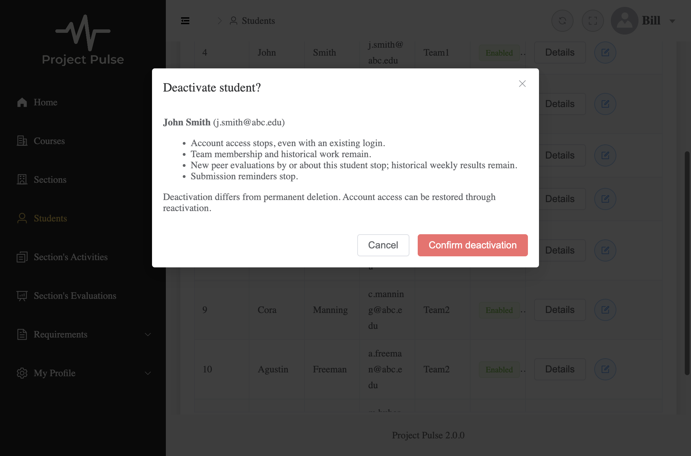

# Student deactivation verification

Traces to [UC-STU-deactivate-student](../requirements/use-cases.md#uc-stu-deactivate-student-the-course-admininstructor-deactivates-a-student), [the approved design](../design/stu.md), [issue #1](https://github.com/Tee123455/add-a-use-case/issues/1), and [merged design PR #2](https://github.com/Tee123455/add-a-use-case/pull/2).

## Review boundaries

The human approved trunk commit `d635375` before endpoint, security, or frontend leaves were built. `9ab5f73` adds the endpoint; `6d0192d` contains the initial SecurityConfiguration changes (with its manager and security tests), and `b9f59b5` contains the separately approved details-route correction; `92abaf9` adds student management/profile UI; `9e88802` adds concurrency/reminder verification; `bb34646` adds evaluation recovery; `4aa4295` strengthens complete-account preservation assertions. No schema migration or new reactivation flow was added. The existing intentional inactive-to-active generic profile path remains unchanged in capability.

The architecture authentication-gap clarification was explicitly approved in this session. The student design now links execution evidence instead of calling the implementation merely proposed. One design correction was separately approved during implementation: compose the student-details GET guard with the dedicated deactivation guard, allowing an owning course admin to complete main step 2 without section assignment. The existing shared guard and other routes remain unchanged; no policy or component boundary changed. Evaluation recovery merges saved rows with remaining active drafts so partial submissions can continue without duplicate creates; Refresh never submits a draft.

## Execution results

Suite results and the completed mutation exercise are recorded separately below. A successful bundle build does not imply a successful TypeScript check.

- Final full backend suite: **477 tests across 47 classes; 0 failures, 0 errors, 0 skips**, after the approved GET-route correction. Targeted security, service, endpoint, notification and concurrency checks also passed before their commits.
- The student-management Cypress spec passes 12 tests, and the real-backend evaluation recovery spec passes one test.
- Full Cypress run: 24 passed, 4 failed, 4 skipped across 32 tests. Both new specs (13 tests) and all reminder tests (9) passed. Untouched login/menu specs fail on the stale `h1` login-heading expectation and use of `john` instead of the seeded email username; failures skip the remaining menu tests.
- `npm run build-only` passes. The merged design commit `f27c5b1` and this implementation produce the same 18 existing TypeScript diagnostics; the changed modules add no TypeScript diagnostic. The baseline was checked from a temporary `git archive` using the same locked dependencies.

Commands used from the repository root (frontend commands run inside `frontend/`):

```sh
bash backend/mvnw -q -f backend/pom.xml test
cd frontend
npm run build
npm run build-only
env -u ELECTRON_RUN_AS_NODE node_modules/.bin/cypress run --browser electron
```

Browser tests use the local MySQL/Mailpit/backend/Vite stack. The evaluation spec creates an invited test evaluator, receives the real invitation in Mailpit, registers and assigns her through existing APIs, then deactivates and unassigns her during cleanup. Historical test evaluations remain, consistent with the lifecycle policy. Successful responses are real; controlled server/network/authentication failures, pending-response timing, and request-absence assertions use interception. The browser calendar is aligned with the established backend dev clock for evaluation-window tests.



## Approved test-list coverage

| Row | Evidence | Limit / interpretation |
| --- | --- | --- |
| T1 | `StudentDeactivationControllerTest.returnsSpecifiedOutcomeAndInactiveStudent`; `StudentDeactivationSecurityIntegrationTest.authorizedActorsDeactivateAndRepeatWithExactMessage`; Cypress warning/confirmation test | `courseOwnerCanViewDetailsAndDeactivateWithoutSectionAssignment` also covers an owner outside the section instructor set. Backend covers both authorized actor types; browser confirms the assigned-instructor flow. |
| T2 | `StudentDeactivationSecurityIntegrationTest.unauthorizedTargetsAndMalformedIdsNeverMutate`; `StudentDeactivationIntegrationTest.scopesAssignedInstructorAndCourseOwnerWithoutDefaultSectionRestriction`; direct service refusal tests | Includes unrelated instructor/admin, student self/other, nonexistent/malformed IDs, and a caller with no selected default section. |
| T3 | Four Cypress dismissal cases in `student-deactivation.spec.cy.js` | Cancel, close, Escape, and backdrop each assert zero deactivation requests and unchanged persisted status. |
| T4 | Service no-op test; controller outcome test; real endpoint repeat test; `simultaneousDeactivationsProduceOneChangeAndOneNoOp`; Cypress stale warning | Concurrent service transactions yield one changed and one unchanged outcome; unauthorized endpoint repeat is still denied. |
| T5 | `committedDeactivationRejectsOldTokenReadWriteAndFreshBasicLogin` | A real token predates committed endpoint deactivation. Subsequent read/write and Basic login fail; profile mutation does not occur. |
| T6 | `persistsOnlyStatusAndSupportsNoTeamAndRepeatedRequests` and service membership assertions | Team/section identifiers remain; no-team deactivation succeeds. |
| T7 | `persistsOnlyStatusAndSupportsNoTeamAndRepeatedRequests` | Compares complete account row except enabled, and complete activity/evaluation/rating table snapshots. |
| T8 | Inactive participant unit tests; `deactivationBlocksNewEvaluationsButPreservesRecordedWeekWithoutTeam`; `existingEvaluationAboutInactiveTargetRemainsEditableInOpenWindow`; `deactivation-evaluations.spec.cy.js` | Real browser stale-target refusal, named error, roster refresh, preserved draft and active continuation; historical editing keeps its existing window. |
| T9 | `inactiveReportRowsDependOnRecordedWeekAndKeepInactiveAuthorsScores`; `deactivationBlocksNewEvaluationsButPreservesRecordedWeekWithoutTeam` | Recorded week keeps totals/comments, including inactive authors; empty week omits inactive students; removed membership does not hide recorded results. |
| T10 | `ReminderIntegrationTest.deactivatedStudentReceivesNeitherOnDemandNorScheduledReminder`; `SubmissionStatusServiceTest`; `SubmissionStatusServiceIntegrationTest` | Actual on-demand and scheduled consumers exclude the student; obligations require only active teammates, including self. |
| T11 | Cypress server/network failure, pending duplicate prevention, shared 401 logout tests | A lost response does not prove no commit occurred. The UI must not invent success or change status optimistically. |
| T12 | `ActiveAccountJwtValidatorTest`; security integration active/inactive role, time/identity, deletion/signature and lookup-failure tests | Default time/signature validation remains; invalid/deleted/disabled identities and infrastructure failures never grant access. |
| T13 | `genericEditCannotDeactivateOrSaveProfileChanges`; `StudentIntegrationTest.genericEditRefusesDeactivationAndRequiresExpectedStatus`; browser disabled-switch test | Refusal precedes profile-field mutation; the UI directs the user to the dedicated action. |
| T14 | Stale service test; lock-wait integration test; retained status-update unit/HTTP tests; both Cypress profile caller tests | Required original snapshot is separate from desired status; stale save gets 409; missing parameter gets 400; no automatic retry. |

## Test critique decisions

At the student's direction, the agent implemented these recommendations. Keep the existing tests and their oracle mapping below; no whole test was dropped. This records the accepted changes, not a claim that the student personally read every test.

- **Keep:** real-token enforcement, route and independent service authorization, stored-record preservation, concurrency, evaluation eligibility/history, reminder consumers, and browser confirmation/cancellation/failure/recovery tests. Unit and integration coverage serve different purposes: exact no-save assertions versus real persistence, security and transactions.
- **Change T14 concurrency evidence:** replace the 200 ms future timeout with an observation of the profile worker's actual InnoDB lock wait in `performance_schema.data_lock_waits`. The observer uses a separate root connection to the disposable test container, since observing other transactions requires privileges beyond the application account. A bounded polling timeout only limits test duration; elapsed time is no longer the oracle. Keep the final conflict and unchanged-profile assertions.
- **Change T9 historical evidence:** capture stored public/private comments and individual criterion scores before deactivation; after deactivation and membership removal, assert exact comment contents and independently calculated criterion averages, alongside the explicit seeded total average of 50. This tests preservation through real persistence without deriving expected values from the report method.
- **Change T14 browser evidence:** add a fresh inactive profile case that intentionally requests `enabled=true`, asserts the separately transmitted `expectedEnabled=false`, and verifies the real response and persisted account status. This exercises retained existing behavior, without adding a reactivation feature.
- **Drop:** the timing-only lock-wait assertion. The concurrency test itself remains.
- **Mutation outcome:** keep the JWT post-commit test unchanged because the selected production mutation made it fail and restoring production behavior made it pass; see the exercise below.

Validation of these changes on November 6, 2026: `StudentDeactivationIntegrationTest` passed all five tests with zero failures/errors/skips. The complete updated `student-deactivation.spec.cy.js` passed all 13 browser tests against the local app, including the new inactive-snapshot case. Both commands exited 0; `git diff --check` passed. The evaluation browser spec and the full backend suite were not rerun for these test-only changes. Local logs: `/tmp/stu-strengthened-backend.log` and `/tmp/stu-strengthened-cypress.log`.

```sh
bash backend/mvnw -q -f backend/pom.xml -Dtest=StudentDeactivationIntegrationTest test
# From frontend/:
env -u ELECTRON_RUN_AS_NODE node_modules/.bin/cypress run --browser electron --spec cypress/e2e/student-deactivation.spec.cy.js
```

## Candidate test oracles for human critique

These are the agent's proposed tests, not a claim that the student has independently accepted them. Parameterized invocations share the named method's oracle. Existing regression suites are reused rather than claimed as newly authored.

| Test | Independent expected-result source |
| --- | --- |
| `StudentDeactivationServiceTest.changesOnlyEnabledAndRepeatDoesNotSave` | UC extensions 6a/6c; BR-student-lifecycle; T4/T6 |
| `refusesForeignTargetBeforeMutation` | UC 3a; BR-section-scoped-access; T2 |
| `studentCannotDeactivateEvenHerself` | UC 3a2; T2 |
| `genericEditCannotDeactivateOrSaveProfileChanges` | Dedicated-action contract; T13 |
| `staleProfileSaveConflictsWithoutChangingAnyFields` | UC Associated Information competing saves; T14 |
| `freshInactiveProfileRetainsExistingInstructorStatusUpdate` | Approved API contract's retained behavior; T14 |
| `StudentDeactivationControllerTest.returnsSpecifiedOutcomeAndInactiveStudent` | Main step 6 and exact extension 6a message; T1/T4 |
| `StudentDeactivationIntegrationTest.scopesAssignedInstructorAndCourseOwnerWithoutDefaultSectionRestriction` | UC 3a; approved scope decision; T2 |
| `persistsOnlyStatusAndSupportsNoTeamAndRepeatedRequests` | UC 6a/6c/6d; BR-student-lifecycle; T4/T6/T7 |
| `deactivationBlocksNewEvaluationsButPreservesRecordedWeekWithoutTeam` | UC 6d; BR-evaluation-active-participants; T8/T9; seeded scores 47,54,49 average to 50 |
| `staleProfileWaitingBehindDeactivationCannotReactivate` | Atomic competing-save contract; T14 |
| `simultaneousDeactivationsProduceOneChangeAndOneNoOp` | Idempotent extension 6a; T4 |
| `EvaluationServiceTest.rejectsNewEvaluationOfInactiveTeammate` | BR-evaluation-active-participants; T8 |
| `rejectsNewEvaluationByInactiveStudent` | BR-evaluation-active-participants; T8 |
| `inactiveReportRowsDependOnRecordedWeekAndKeepInactiveAuthorsScores` | BR-evaluation-active-participants; T9; explicit seeded score average 50 |
| `testUpdatePeerEvaluation(boolean)` | BR-evaluation-active-participants preserves existing editing rules; T8 |
| `ActiveAccountJwtValidatorTest.observesDeactivationAndDeletionOnSubsequentValidation` | FR-SEC-active-account; T12 |
| `invalidIdentityFailsClosed` | Approved fail-closed identity decision; T12 |
| `absentAndFractionalClaimsFailClosed` | Approved stable valid userId decision; T12 |
| `databaseFailureCannotReturnSuccessfulValidation` | Approved infrastructure-failure decision; T12 |
| `StudentDeactivationSecurityIntegrationTest.authorizedActorsDeactivateAndRepeatWithExactMessage` | Main step 6, 6a, BR-student-lifecycle; T1/T4 |
| `unauthorizedTargetsAndMalformedIdsNeverMutate` | UC 3a; fail-closed API contract; T2 |
| `committedDeactivationRejectsOldTokenReadWriteAndFreshBasicLogin` | UC 6b; FR-SEC-active-account; T5 |
| `activeRolesWorkAndInactiveInstructorCannotLoginOrReuseToken` | FR-SEC-active-account/authorization; T12 |
| `rejectsExpiredFutureMalformedAndUnresolvableIdentityTokens` | Approved default-validation and identity decisions; T12 |
| `deletedAccountAndTamperedSignatureAreRejected` | Approved default-validation and deleted-account decisions; T12 |
| `accountLookupFailureDoesNotExecuteProtectedMutation` | Approved database-failure decision; T12 |
| `existingEvaluationAboutInactiveTargetRemainsEditableInOpenWindow` | BR-evaluation-active-participants and existing edit-window rules; T8 |
| `courseOwnerCanViewDetailsAndDeactivateWithoutSectionAssignment` | Main step 2, extension 3a; BR-student-lifecycle; separately approved scoped GET guard correction |
| `freshInactiveProfileCanUseRetainedIntentionalStatusUpdate` | Retained existing generic profile behavior; T14 |
| `StudentIntegrationTest.genericEditRefusesDeactivationAndRequiresExpectedStatus` | Dedicated-action contract and required snapshot parameter; T13/T14 |
| `ReminderIntegrationTest.deactivatedStudentReceivesNeitherOnDemandNorScheduledReminder` | UC 6d; BR-submission-owed; T10 |
| Cypress warning/confirmed persistence | Main steps 2–6 and Associated Information warning; T1 |
| Cypress four cancellation cases | Extension 4a; T3 |
| Cypress already-inactive race | Extension 6a; T4 |
| Cypress server/network failures | Backend-confirmed success contract; T11 |
| Cypress duplicate prevention | Pending-state decision; T11 |
| Cypress 401 logout | Existing shared interceptor contract; T11 |
| Cypress disabled generic status/stale edit | Dedicated action and competing-save contract; T13/T14 |
| Cypress current-user profile conflict | Both profile callers carry original snapshot; T14 |
| Cypress evaluation recovery | BR-evaluation-active-participants; UC-EVA-submit-evaluation 9a; T8 |

The retained inactive-profile HTTP test uses separate committed requests: its initial fixture shared one outer test transaction, allowing a refresh to discard an unflushed flag update. The fixture was corrected to model the production request boundaries; no production change was made for that test setup.

Existing student profile regression tests now send expectedEnabled and request ordinary profile updates; forbidden deactivation has its own negative tests. The network-failure browser test was corrected: lack of a response is not an oracle for absence of a server commit. No production code was changed to satisfy that incorrect assertion.

## Mutation exercise

The student selected JWT account-status enforcement as the least-trusted area. On November 6, 2026, at the student's request, the agent completed the mutation exercise against `StudentDeactivationSecurityIntegrationTest.committedDeactivationRejectsOldTokenReadWriteAndFreshBasicLogin`. The oracle is UC extension 6b, FR-SEC-active-account and design rows T5/T12: a real token obtained before committed deactivation must no longer grant protected access.

The one-line mutation in `ActiveAccountJwtValidator.validate` changed `findById(id).filter(user -> user.isEnabled()).isPresent()` to `findById(id).isPresent()`. This retained the account-existence check while bypassing account-status enforcement.

- **Red:** the single selected test failed at line 93: `Status expected:<401> but was:<200>`. Maven exited 1; one test ran, with one failure and no errors. The deactivated student's old JWT reached the protected student-details read. The test stopped at that assertion, so this mutation run does not independently demonstrate the later write/login assertions.
- **Green:** the original enabled-account filter was restored, and the identical test passed: one test, zero failures, zero errors, zero skips; Maven exited 0. This run also reached the protected write, fresh Basic login and unchanged-profile assertions.
- **Outcome:** the test detected the selected regression and was kept unchanged. No production mutation remains; the validator matches the reviewed commit. Execution logs are local at `/tmp/stu-jwt-mutation-red.log` and `/tmp/stu-jwt-mutation-green.log` and are not committed because test debug output includes authentication data.

Both runs used local Docker/MySQL via Testcontainers and the same command:

```sh
bash backend/mvnw -q -f backend/pom.xml '-Dtest=StudentDeactivationSecurityIntegrationTest#committedDeactivationRejectsOldTokenReadWriteAndFreshBasicLogin' test
```

The earlier mutation attempt was declined before execution; the results above are from the subsequently authorized exercise. This agent-executed check does not replace the student's independent test critique or personal review.

## Human review still required

- Critique each candidate test, decide which to keep/rewrite/drop, and record the decision under the PR's **The tests I kept**.
- Review the commit triage and each design test-list row; the mapping above is evidence prepared by the agent, not the student's review.
- Leave at least one labeled Conventional Comment on the GitHub diff.
- Run a fresh-context review in a new session with the PR diff, merged use case and design. Record every finding and its fixed/rejected/follow-up outcome.
- Leave the build PR open. No merge is authorized.

Not verified here: the student's independent test critique/inline review; production deployment, account-status lookup performance at load, and cancellation of already-executing requests. The last item is explicitly outside extension 6b's guarantee. A separate fresh-context review reported no actionable findings and reran 32 targeted tests successfully; this mutation exercise adds the red/green result above.

## Documentation verification

Mechanical checks found no numbered headings, explicit anchors, stale contents headings or smart quotes in the five core requirements documents. The deterministic scan resolved concrete requirement IDs and relative Markdown links, matched all 98 UC headings to 98 matrix rows, found matching feature/FR bindings, 7 quality-scenario IDs, 9 risk IDs and 10 success-metric IDs, and found no drift in the BR-to-UC backward index. Requirements content and its BR/SRS citations were not changed in this implementation.

Existing structural findings remain outside this use case: 25 active UCs have empty extension fields; traceability repeats the heading "How to use it" at lines 49 and 231; a numeric-bound heuristic flags qualitative security/maintainability requirements for human judgment. These were reported rather than silently rewritten. Judgment checking was limited to the changed student design, account-status architecture paragraph, traceability rows and their immediate requirement references; this is not a claim of a full semantic review of the requirements corpus.
